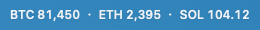
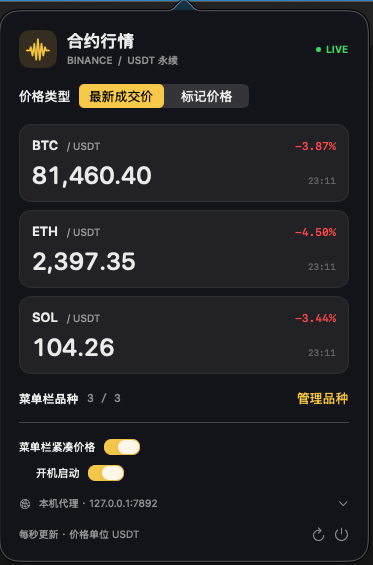

# FuturesBar · macOS 菜单栏版

[返回项目首页](../README.md) · [Windows 文档](windows.md)

在 Mac 右上角菜单栏查看 Binance USDT 永续合约价格，最多显示三个品种。

## 下载与安装

**[下载 Mac 安装包（DMG · v0.1.3）](https://github.com/LuoNova94/FuturesBar/releases/download/v0.2.1/FuturesBar-0.1.3-arm64-unnotarized.dmg)**

适用于 Apple 芯片 Mac（M1 及更新芯片），需要 macOS 13 或更新版本，目前不提供 Intel 安装包。

1. 打开 DMG，将「合约行情.app」拖入「应用程序」。
2. 启动应用，点击右上角菜单栏价格打开行情面板。
3. 升级前先退出旧版，再替换应用；已有品种和网络设置会保留。

此安装包使用临时签名，尚未经过 Apple 公证。首次打开说明见 [安装指南](../macos/INSTALL.txt)。[版本说明、源码与校验文件](https://github.com/LuoNova94/FuturesBar/releases/tag/v0.2.1)。

## 界面预览

**菜单栏实时行情**



**行情面板**



截图中的价格和代理端口仅为示例，新安装默认跟随系统网络设置。

## 股票与 ETF 合约

支持 Binance 交易中的 TradFi USDT 永续合约。搜索 `KORU`、`SpaceX`（实际合约代码 `SPCXUSDT`）、`TSLA`、`NVDA` 等即可添加；可与 BTC 等品种混合选择，合计最多三个。价格来自 Binance 合约行情，单位为 USDT。

## 使用

打开「应用程序」中的「合约行情.app」，右上角菜单栏出现 BTC、ETH、SOL 的价格。点击价格打开面板。

- 「管理品种」：搜索 Binance 当前处于交易状态的 USDT 永续合约；最多选择 3 个，至少保留 1 个。
- 在已选品种卡片上使用上下箭头调整菜单栏顺序，减号移除品种。
- 切换「最新成交价」和「标记价格」。最新成交价卡片右上角为滚动 24 小时涨跌幅。
- 「菜单栏紧凑价格」：千元以上价格在菜单栏四舍五入为整数；面板保留两位小数。小价格按量级保留最多 8 位。
- 行情每秒推送，15 秒未更新即隐藏价格并显示过期状态；断线自动退避重连，睡眠后唤醒自动恢复。
- 品种、顺序、价格类型和紧凑模式保存在此应用的本机偏好中。
- 「开机启动」使用 macOS 登录项。建议将 app 拖入「应用程序」后再启用；若系统要求允许，在「系统设置 → 通用 → 登录项」中确认。
- 新安装默认跟随 macOS 系统网络设置，不预填或启用特定代理端口。点击面板下方的「网络 · 跟随系统」，打开「手动配置本机代理」后可填写 HTTP / 混合代理端口，地址为 `127.0.0.1`；保存后立即重连。关闭手动代理后恢复跟随系统，无需填写端口。这些设置只影响此工具，不改变系统设置。
- 升级会保留已有的网络配置；0.1.1 及以前已使用的隐式本机代理会迁移为明确保存的配置。

不需要 Binance 账号或 API Key，应用只访问公共行情接口。需要本机网络能访问 Binance 行情服务。支持 Binance 普通永续与 TradFi 永续（股票、ETF 等），仅接收交易中的 USDT 合约，不包含币本位、USD1、USDC 或交割合约。

## 构建与验证

Mac 源码与测试位于 `macos/`，与 `windows/` 并列。使用 Swift / AppKit / SwiftUI，需要安装 Xcode 或 Swift 命令行开发工具。以下命令均在仓库根目录执行。

```sh
zsh macos/build.sh
zsh macos/check.sh
zsh macos/check-layout.sh
FUTURES_PROXY_PORT=7892 zsh macos/check.sh --live
```

最后一项会真实请求品种列表，并分别接收 BTC、ETH、SOL 的最新成交价及标记价格，失败返回非零状态。

`check-layout.sh` 需要 macOS 桌面会话，会使用固定合约数据循环展开、收起、开关弹窗并改变菜单栏文字宽度，检查首次显示时及布局稳定后的弹窗都位于屏幕内、顶部紧贴菜单栏。弹窗通过 hosting controller 的 `preferredContentSize` 同步尺寸，显示前先完成布局，避免使用旧高度定位后再跳回。

产物使用本机临时签名，不是用于对外分发的 Apple 公证版本。重建前请退出正在运行的 app。

## 打包与发布

目前提供 Apple 芯片的未公证试用版，需要 macOS 13 或更新版本。安装和首次打开说明见 [INSTALL.txt](../macos/INSTALL.txt)。

```sh
zsh macos/package-release.sh
```

脚本会重新构建应用，生成 DMG、独立源码 ZIP、SHA-256 校验文件和发布说明，存放于 `output/releases/v<版本号>/`。DMG 包含应用、「应用程序」快捷入口、安装说明和许可证。源码 ZIP 不包含构建缓存、应用二进制、Git 历史或本机偏好设置。

在 GitHub 创建公开仓库时，仅上传此工具的源码文件，排除 `.build/`、`output/` 和 `.swiftpm/`。创建对应版本标签的 Release，以 `macos/RELEASE.md` 为说明，上传 DMG、源码 ZIP 和 `SHA256SUMS.txt`；安装包无需提交到 Git 历史中。

## 许可证

本项目使用 [MIT License](../LICENSE)。

## 行情契约

- 品种：`GET https://fapi.binance.com/fapi/v1/exchangeInfo`
- 最新成交价：`wss://fstream.binance.com/market/stream?streams=btcusdt@ticker/...`，字段 `c` 为价格、`P` 为百分比涨跌。
- 标记价格：同一路由，stream 为 `btcusdt@markPrice@1s`，字段 `p` 为价格。
- 校验事件类型与事件时间；收到过期、错序或其他品种数据时不显示为实时行情。
- 官方说明：[WebSocket 连接](https://developers.binance.com/en/docs/products/derivatives-trading-usds-futures/websocket-market-streams/Connect)、[行情字段](https://developers.binance.com/en/docs/catalog/core-trading-derivatives-trading-usd-s-m-futures/api/ws-streams/market)、[品种列表](https://developers.binance.com/en/docs/catalog/core-trading-derivatives-trading-usd-s-m-futures/api/rest-api/market-data)。
