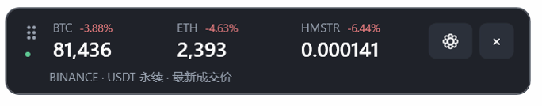

# FuturesBar · Windows 悬浮行情条

C# / .NET 10 / WPF，使用 Windows Forms 的 NotifyIcon 提供托盘菜单。没有浏览器运行时或第三方 NuGet 库。

## 下载与安装

**[下载 Windows 11 x64 预览版（ZIP · v0.2.1）](https://github.com/LuoNova94/FuturesBar/releases/download/v0.2.1/FuturesBar-0.2.1-win-x64-preview.zip)**

将 ZIP 完整解压到固定文件夹，双击 `FuturesBar.exe`，无需另装 .NET。使用说明见 [INSTALL.txt](INSTALL.txt)，版本说明、源码包与 SHA-256 校验文件见 [Windows 预览版 Release](https://github.com/LuoNova94/FuturesBar/releases/tag/v0.2.1)。

此版本未签名，尚未完成 Windows 实机界面验收。

## 实机效果



截图由项目作者提供，展示三个品种的最新成交价和涨跌幅。价格仅为截图时的示例。

## 股票与 ETF 合约

支持 Binance 交易中的 TradFi USDT 永续合约。搜索 `KORU`、`SpaceX`（实际合约代码 `SPCXUSDT`）、`TSLA`、`NVDA` 等即可添加；可与 BTC 等品种混合选择，合计最多三个。价格来自 Binance 合约行情，单位为 USDT。

## 功能

- 单行悬浮条，最多三个 Binance USDT 永续合约；价格每秒汇总刷新。
- 拖动、锁定、置顶、透明度；默认不抢键盘焦点。
- 齿轮、双击或右键打开设置；托盘控制显示、隐藏、退出。
- 品种搜索、排序、价格类型、本机 HTTP / 混合代理、当前用户登录后启动。
- 设置保存在 `%LOCALAPPDATA%\FuturesBar\settings.json`。
- 代理默认跟随系统，不包含任何个人网络或账号配置。
- 使用 WebSocket PING/PONG 心跳判定连接健康，安静行情不会触发重连；过期价格以「—」显示。

## 构建

推荐使用 Windows 11 x64 和 .NET 10 SDK：

```powershell
powershell -File windows/build.ps1
```

输出为 `output/windows/win-x64/FuturesBar.exe`，ZIP 为 `output/FuturesBar-0.2.1-win-x64-preview.zip`。发布时包含运行时，用户不需要另装 .NET。建议先解压到固定目录再启用登录后启动。

命令行检查与单独构建：

```sh
dotnet run --project windows/FuturesBar.Checks -c Release
dotnet publish windows/FuturesBar.Windows -c Release -r win-x64 --self-contained true -o output/windows/win-x64
```

可用 `FUTURES_PROXY_PORT` 环境变量指定本机代理，并为检查程序加 `--live` 验证两个行情频道。该变量仅用于检查，不会写入应用默认设置。

## 验证状态

已完成 Windows x64 交叉构建、8 项核心检查，以及 Binance 品种列表、BTC / ETH / SOL 两类真实行情推送检查。

Windows UI 需要在 Windows 实机上验证拖动、多屏缩放、位置恢复、托盘、开机启动和睡眠恢复。跨平台编译成功与行情检查通过，不等于这些 UI 行为已通过验收。预览包尚未签名。

Windows 版与 Mac 版使用相同的市场范围和字段定义，平台界面分别维护。MIT 许可证见仓库根目录。
